  👋 Hi! I work on machine learning and computer vision, and I'm finishing my MSc in Computer Science
  and Engineering at the University of Beira Interior, Portugal.

  
  

### 🔬 What I do
- 🤖 Train and evaluate object detectors: YOLO, Faster R-CNN, RF-DETR
- 🧠 Continual learning: teaching a model new domains without forgetting the old ones (EWC, LwF, replay)
- 🎮 Synthetic data in Unreal Engine 5
- 🌐 Small web tools in TypeScript

### 🧰 Languages and tools

 

 

### 🌱 Projects
<table>
  <tr>
    <td width="50%">
      
    </td>
    <td>
      <h3><a href="https://stardewfarmer.pages.dev">Stardew Valley Farmer Creator</a></h3>
      Plan your farmer's look with every appearance option in vanilla Stardew Valley, and know
      exactly what to pick in the game.
        
      <a href="https://stardewfarmer.pages.dev"><b>Open the site</b></a> · <a href="https://github.com/Daniela17d/stardew-farmer-creator">Code</a>
        
      
    </td>
  </tr>
</table>

  <picture>
    <source media="(prefers-color-scheme: dark)" srcset="https://raw.githubusercontent.com/Daniela17d/Daniela17d/output/github-snake-dark.svg">
    
  </picture>

